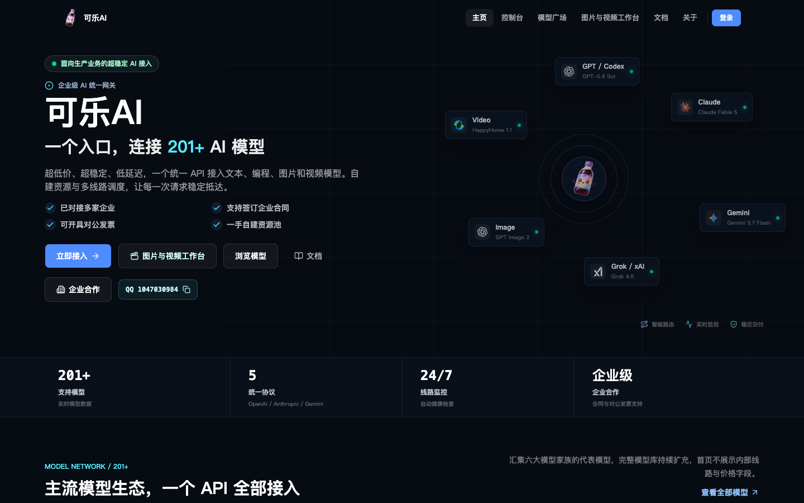
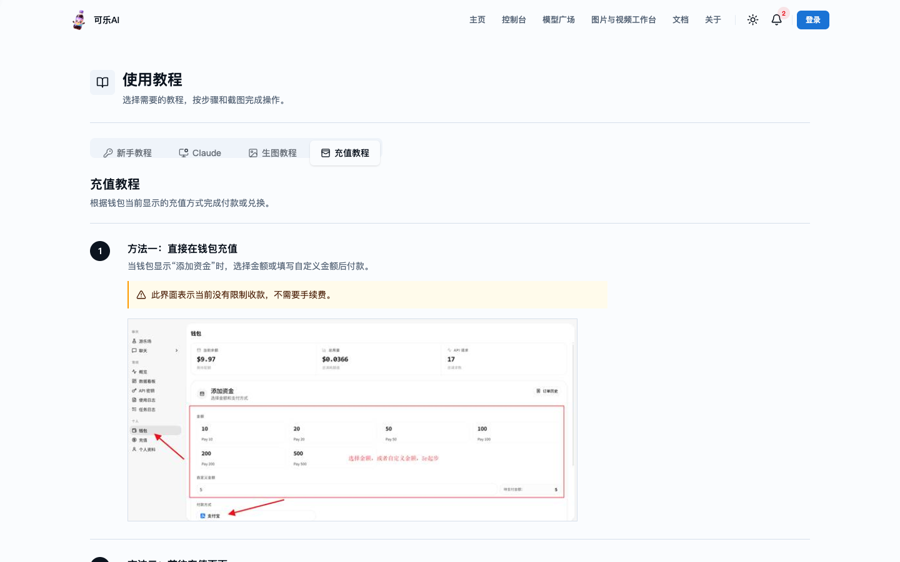
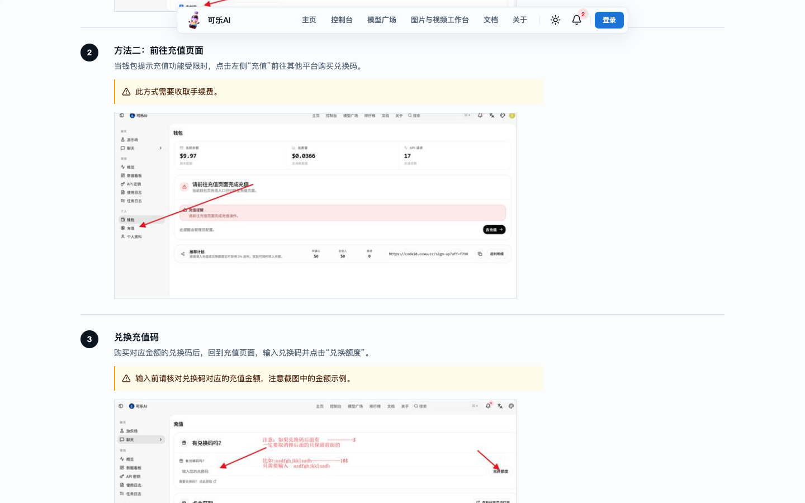
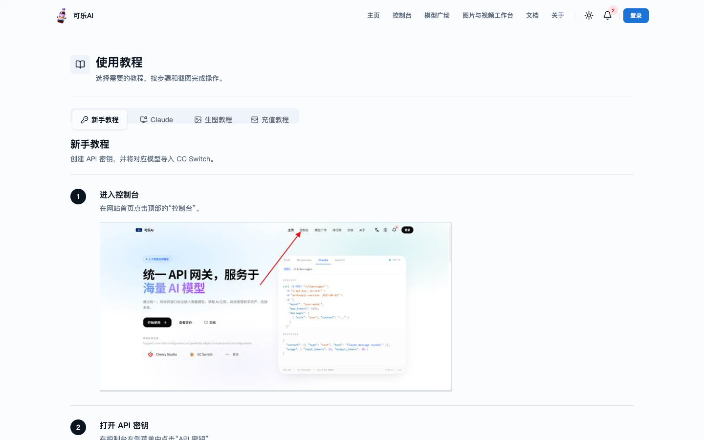

# 可乐AI充值教程：Code28 10元起，GPT 0.1x与CC Switch怎么用

**购买结论：Code28（可乐AI）把低价GPT与多模型控制台组合在一起：GPT最低档0.1x，账户中还能选择Claude、Gemini、Codex、图片和视频模型。它适合从单线中转升级到多模型平台的人。**

[打开Code28注册与价格页](https://code28.ccwu.cc/sign-up?aff=UlEq)

## Code28能替代什么

相比只卖GPT或Codex的站点，Code28能减少换账户的次数；相比模型很多但教程很少的聚合站，它把钱包充值、创建Key和CC Switch导入做成了连续的中文步骤。

## 价格与套餐重点

站方充值教程展示10、20、50、100、200、500元预设金额，并允许自定义。第一次选10～20元即可覆盖分组与客户端测试，不需要先购买大额余额。

## 充值步骤与支付方式

具体流程是注册登录、进入钱包点击添加资金、选择金额、在付款页面完成支付、回到控制台确认到账。教程也展示了充值码入口，提交前应核对兑换金额。

[进入Code28完成注册](https://code28.ccwu.cc/sign-up?aff=UlEq)

## Claude Code / Codex接入

余额到账后不要直接沿用default分组。为Claude、Codex与媒体任务分别建Key，在Key菜单打开CC Switch；Claude选择`claude`开头的型号，Codex选择`gpt`开头的型号。

## 怎样买得更划算

Code28可替代低价但只有单一模型的中转，也可减少多套官方账户的管理工作。必须使用原厂账户与原厂SLA的项目，则继续保留官方线路。

### Code28从充值到调用

1. 钱包页面选择10元或20元预设金额，初次不需要选更高档；
2. 完成页面当前付款流程，若使用充值码则先核对兑换金额；
3. 到账后新建GPT低倍率分组Key，不沿用default；
4. Claude与媒体模型各建一把Key，避免账单混在一起；
5. 从Key菜单打开CC Switch，Claude选`claude`型号，Codex选`gpt`型号。

## Code28购买问题

### 0.1x是不是所有模型都按十分之一结算？

不是。它对应GPT最低价格分组；Claude、Gemini、图片和视频条目有自己的分组及计费单位，应在模型页分别查看。

### 第一次充值选10元还是20元？

只测一个GPT分组可先选10元；还要同时配置Claude Code、Codex和媒体请求时，20元会留出更充足的切换空间。

### CC Switch导入后先测什么？

Codex先做一次小型代码修改，Claude Code再执行一次多文件读取。两项均通过后，才把日常项目迁入Code28。

## Code28结论

可乐AI把0.1x GPT入口、10元起充值、多模型控制台与CC Switch教程放在同一条购买链中。想从单线中转升级到Claude、Codex和Gemini统一账户的人，先用低金额完成两种Coding客户端测试最划算。

[注册Code28并选择10元起充值](https://code28.ccwu.cc/sign-up?aff=UlEq)

Code28搜索关键词

Code28充值教程 · Code28 0.1x · 可乐AI测评 · Code28 Claude Code · Code28 Codex

*本文更新于2026-11-18，充值档位与模型分组以可乐AI页面为准。*

## code28替代与相关搜索

本文覆盖code28价格、code28充值、code28接入，以及它与官方API和单线中转的替代关系。
